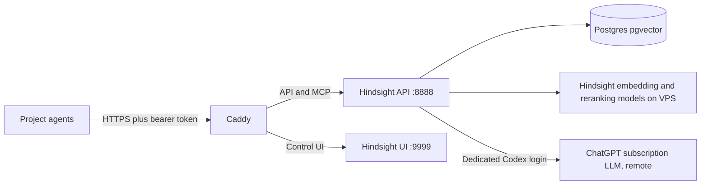

# Hindsight VPS architecture (the owner's own record)

This is the owner's own record of the shared Hindsight server as it is since he moved its model off Ollama (received 2026-10-07; verified by him on 2026-10-07). It is newer than `hindsight-server-setup-guide.md` and wins where the two differ.

This file is a record and is not edited. Any change goes in the owner's original, or in a new record.

---

# Hindsight VPS architecture and project onboarding

_Verified October 7, 2026._

## Purpose and scope

This is one shared Hindsight server for the owner's personal project agents. Each project should use a distinct memory bank. The server handles extraction, storage, recall, and reflection; agents connect through its HTTPS API or a bank-specific MCP endpoint. Bank names organize project data, while the current shared API token grants access to the whole instance. A bank-specific URL is not an authorization boundary.

## Deployment map



| Component | Location or configuration |
| --- | --- |
| VPS | Hostinger KVM 2, Ubuntu 24.04 with Docker, `shared-memory-vps.mrihm-memory.com` |
| Compose project | `/opt/hindsight/compose.yaml` |
| Runtime containers | Hindsight API/UI, Postgres with pgvector, Caddy |
| API and MCP | `https://memory-api.mrihm-memory.com` |
| Control UI | `https://memory.mrihm-memory.com` |
| Database | Compose `db` service; persistent `pg_data` volume |
| TLS and routing | Caddy on VPS ports 80 and 443; API to Hindsight port 8888, UI to port 9999 |
| Secrets | `/opt/hindsight/.env`; never copy values into this guide or project repositories |
| Codex login | `/opt/hindsight/codex-auth/auth.json`, mounted writable at `/codex-auth` in Hindsight; owned by container UID 1000 |
| LLM | `openai-codex` provider, `gpt-5.6-terra`, using the owner's ChatGPT subscription through a dedicated Codex login |
| Language policy | `HINDSIGHT_API_LLM_OUTPUT_LANGUAGE: English` in Compose; applies to retain, consolidation, and reflect |
| Consolidation | Observations enabled; automatic consolidation disabled server-wide, so an agent must request it explicitly |
| Embeddings and reranking | Existing Hindsight local configuration, unchanged by the LLM migration |

The Codex credential belongs only to the Hindsight service. Other agents connect to Hindsight with its API token; they do not need the Codex credential. The subscription is used for Hindsight's LLM work, including retain extraction and reflect. Terra runs remotely through ChatGPT; it is not a model hosted on the VPS. The existing Hindsight embedding and reranking configuration was left unchanged. This uses the subscription's shared usage allowance, so it is not unlimited or guaranteed to avoid future fees or plan changes. Hindsight documents this provider for personal development use.

The English policy asks Hindsight's LLM to write all generated facts, observations, and reflections in English, including when source material or a query is in another language. Proper names should remain intact. It is server-wide and therefore affects every bank; it cannot be changed through a bank's configuration API. Hindsight describes it as a prompt instruction, so it improves consistency but is not a hard language validator. Agents ingesting critical material should review extracted facts before relying on them.

## Create a project bank

1. Choose a stable bank ID such as `project-name`. Confirm an existing bank with that ID does not already contain unrelated data. Banks are independent stores; a write can create a missing bank, but explicit creation makes the setup deliberate.
2. Obtain the Hindsight API token from the VPS owner through an approved secret channel and place it in `HINDSIGHT_API_TOKEN` in the agent environment. The same token currently authorizes access to all banks, so give it only to trusted agents.
3. Create the bank:

   ```sh
   export HINDSIGHT_URL=https://memory-api.mrihm-memory.com
   export BANK_ID=project-name
   curl --fail-with-body -X PUT "$HINDSIGHT_URL/v1/default/banks/$BANK_ID" \
     -H "Authorization: Bearer $HINDSIGHT_API_TOKEN" \
     -H 'Content-Type: application/json' -d '{}'
   ```

4. Connect a Codex project agent to that bank's MCP endpoint:

   ```sh
   codex mcp add hindsight-project-name \
     --url "https://memory-api.mrihm-memory.com/mcp/$BANK_ID/" \
     --bearer-token-env-var HINDSIGHT_API_TOKEN
   ```

   Restart the agent session and verify its Hindsight tools appear. The bank-specific URL selects a bank for the agent's tools, but the shared token is still instance-wide.

5. For an HTTP client, use the same base URL and bearer token. Retain with `POST /v1/default/banks/{bank_id}/memories`, recall with `POST /v1/default/banks/{bank_id}/memories/recall`, and reflect with `POST /v1/default/banks/{bank_id}/reflect`. Retain submits an `items` array with `content` and an optional `document_id`; recall and reflect submit a `query`. Check operation results before treating a write as accepted.

   ```sh
   curl --fail-with-body -X POST "$HINDSIGHT_URL/v1/default/banks/$BANK_ID/memories" \
     -H "Authorization: Bearer $HINDSIGHT_API_TOKEN" \
     -H 'Content-Type: application/json' \
     -d '{"items":[{"content":"A project fact to remember.","document_id":"example-1"}],"async":false}'

   curl --fail-with-body -X POST "$HINDSIGHT_URL/v1/default/banks/$BANK_ID/memories/recall" \
     -H "Authorization: Bearer $HINDSIGHT_API_TOKEN" \
     -H 'Content-Type: application/json' -d '{"query":"What was the project fact?"}'
   ```

6. If the project uses observations, trigger consolidation after reviewing retained facts. It consumes ChatGPT allowance and creates synthesized knowledge. Automatic consolidation is disabled, so retain does not trigger this step.

   ```sh
   curl --fail-with-body -X POST "$HINDSIGHT_URL/v1/default/banks/$BANK_ID/consolidate" \
     -H "Authorization: Bearer $HINDSIGHT_API_TOKEN" \
     -H 'Content-Type: application/json' -d '{}'
   ```

   The response contains an `operation_id`. Check `GET /v1/default/banks/{bank_id}/operations/{operation_id}` until it reports `completed` or `failed`. Hindsight may produce zero observations if it finds no useful synthesis.

For Entrevest, Diligence Ready, CentraView, and Robin, follow the [live Agent Contract](https://app.notion.com/p/3e8a27b433e481c3bb83e05a5002c105) and routing rules before writing durable knowledge. A new bank or automatic capture hook must not bypass the approved Notion and Lore review flow.

## Operations and recovery

Use `cd /opt/hindsight && docker compose ps` for status and `docker compose logs --tail=100 hindsight` for service errors. The public API health check is `https://memory-api.mrihm-memory.com/health`. A database dump is saved as `/opt/hindsight/hindsight-backup-2026-10-07.sql.gz` and the original Compose file as `/opt/hindsight/compose.yaml.pre-codex-2026-10-07`, both with restrictive permissions. Keep periodic off-VPS backups as well; an on-VPS copy does not survive loss of the server.

The ChatGPT login refreshes tokens in the writable auth directory. If retain or reflect reports `refresh_token_reused`, repeat a dedicated Codex login for this directory and restart Hindsight; do not copy a Mac Codex auth file into it. ChatGPT usage limits are shared with the owner's other Codex sessions. Retest reflection after the login has had time to refresh; a same-day test cannot prove long-term refresh. Restore the pre-migration Compose file and bring the stack back up if a rollback to Ollama is needed; the old Ollama data volume remains available for this purpose.

### Migration validation

On October 7, 2026, the public API health check succeeded, and Terra retain, recall, and reflect each returned HTTP 200. The English test fact was stored and recalled in English, and reflection answered in English. After setting the language policy, Hindsight's prompt preview showed an active `llm_output_language=English` block. Terra's dry-run extraction returned English facts from both English and Spanish source text; a persistent retain succeeded, and reflection answered in English despite a Spanish query.

The test bank's effective configuration reported `enable_observations=true` and `enable_auto_consolidation=false`. Retain left its observation count at zero. An explicit consolidation operation completed and produced two English observations from substantive test facts, which recall returned. All three scratch banks were then deleted; the final bank list was empty. Caddy and Hindsight were running, and Postgres reported healthy.

During model selection, `gpt-5.4-mini` was rejected as unsupported for this ChatGPT account. A `gpt-6-luna` extraction unexpectedly produced a Russian fact from English input. At the time, `HINDSIGHT_API_LLM_OUTPUT_LANGUAGE` was unset and Hindsight asked the model to use the source language. The exact reason that model ignored the instruction is unproven. A subsequent `gpt-5.6-luna` test, then the final Terra test, both produced English results. Terra is the selected production model. Monitor extraction language on real inputs and correct any stray facts through the normal bank review process.

## Initial deployment review

| Area | Current state | Next action |
| --- | --- | --- |
| Authentication | The API and MCP require the configured bearer token; an unauthenticated MCP request returned 401. The control UI has a separate access key. | Keep both secrets out of project files; distribute the API token only through a secret channel. |
| Persistence | External Postgres with pgvector and a persistent `pg_data` volume; the Hindsight service waits for DB health. | Keep database backups on a schedule. |
| Backup | A migration-day SQL dump and Compose copy are on the VPS. | Arrange encrypted off-VPS backups and a restore drill. An on-VPS copy cannot protect against VPS loss. |
| Availability | Docker restart policies are set; the public `/health/ready` endpoint can check API and database readiness. | Add an external uptime alert if this becomes a relied-on service. |
| Upgrades | Hindsight currently uses the `latest` image tag. | Pin a tested release or digest before routine upgrades, and back up before changing image versions. |
| Extraction errors | `HINDSIGHT_API_FAIL_ON_EXTRACTION_ERRORS` remains at its default `false`; partially failed extraction can be reported as completed. | Consider setting it to `true` for workloads where a dropped fact must fail the operation. Test this with the project's ingestion client first. |
| Consolidation | Observation consolidation is enabled, while automatic consolidation is disabled. | Trigger it only when a project's memory policy allows synthesized observations and the added ChatGPT usage. |
| Embeddings | Existing local embedding and reranking behavior was preserved. | Do not change embedding model or dimensions for an existing populated database without a migration plan. |

No additional LLM key, separate MCP token, distributed worker, or monitoring stack is required for this personal one-VPS deployment. The existing tenant API-key extension already protects MCP, and the single worker has a stable ID. Hindsight's metrics and distributed-worker options are available if usage grows.

## Appendix: former Ollama configuration

Before this migration, `/opt/hindsight/compose.yaml` ran an `ollama` service alongside Caddy, Hindsight, and Postgres. Hindsight used `HINDSIGHT_API_LLM_PROVIDER: ollama`, `HINDSIGHT_API_LLM_MODEL: qwen3:4b`, and `HINDSIGHT_API_LLM_BASE_URL: http://ollama:11434/v1`. Its Ollama context setting was 8192. The Ollama container had one parallel request, one loaded model, and an 8192 context limit. Hindsight depended on the Ollama service. Ollama model data lived in the `ollama_data` Docker volume.

The migration removed the Ollama service and its Compose dependency, allowing the Ollama container to stop while retaining `ollama_data` for rollback. Postgres and its `pg_data` volume remain. The former Compose file also explicitly disabled observations. The current setup enables manual consolidation and leaves automatic consolidation off. Embedding settings were not changed. The pre-migration Compose copy above preserves the full former configuration.

## Sources

- [Hindsight models and Codex provider](https://hindsight.vectorize.io/developer/models)
- [Hindsight memory banks](https://hindsight.vectorize.io/developer/api/memory-banks)
- [Hindsight MCP server](https://hindsight.vectorize.io/developer/mcp-server)
- [Hindsight quick start](https://hindsight.vectorize.io/developer/api/quickstart)
- [Hindsight multilingual and output language configuration](https://hindsight.vectorize.io/developer/multilingual)
- [Hindsight observations and manual consolidation](https://hindsight.vectorize.io/developer/observations)
- [Hindsight configuration reference](https://hindsight.vectorize.io/developer/configuration)
- [Hindsight installation](https://hindsight.vectorize.io/developer/installation)
- [Hindsight monitoring](https://hindsight.vectorize.io/developer/monitoring)
- [Codex authentication](https://learn.chatgpt.com/docs/auth)
