# Project-wide records: workflow diagrams

Status: Design examples for TKV-19. These flows are proposed, not built or approved as Toolkit V2 behavior.

These diagrams belong to the Toolkit V2 design record. They are not copied into client projects. The proposed project skill will carry the working instructions and a smaller example that an agent needs while doing the work.

## Terms and record owners

"Knowledge" means all useful project information, not one folder. A source is evidence. A work item owns the change being made and its questions, requirements, design, tasks, and status. `requirements/` owns maintained accepted behavior. `system-guide/` describes verified current structure. Memory holds selected lasting context under the chosen memory system's rules. Proposed `project-wide-records/` holds only the five cross-item record types below.

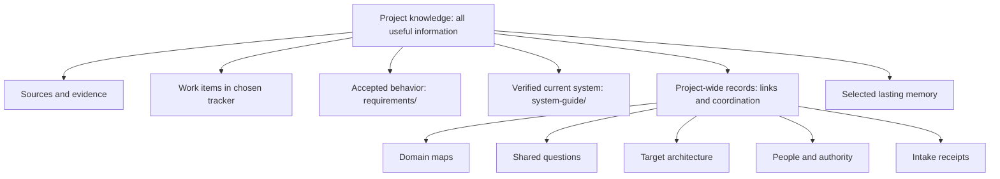

The arrows classify information. They do not mean every source is copied into every record.

## 1. Set up a new client project

The project-wide pattern is standard. The owner still chooses only the work tracker, memory, Salesforce setup, and the other existing setup answers.

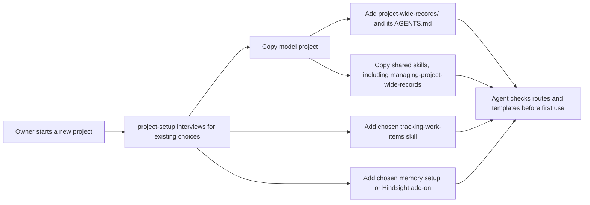

No intake receipt, person record, or domain page is filled with invented content during setup.

## 2. Discovery workshop affects several work items

Example: two Salesforce orgs assign Account ownership differently. Migration, security, and Account design all depend on the answer.

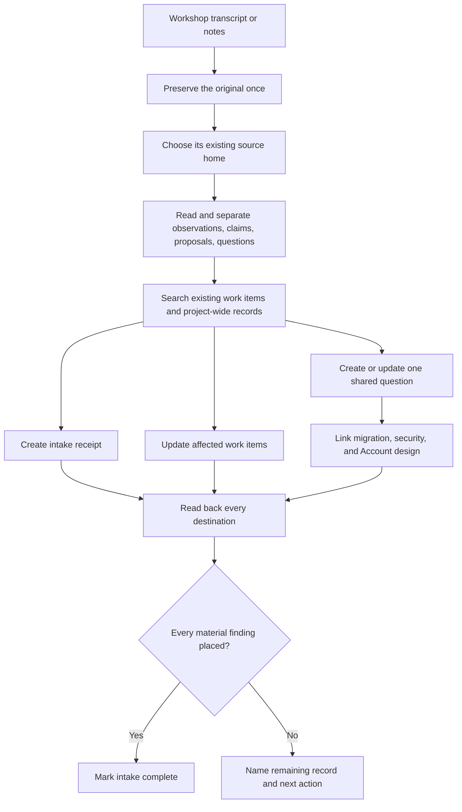

In a non-Salesforce project, one work item anchors a source spanning items: a local `references/` file, a Notion Files entry, or a GitHub source comment. The intake receipt names the anchor item and source. A Salesforce client file stays in `delivery/` or an existing `engagement/`. The receipt never becomes a second transcript. Notion's temporary file download URL is not a lasting source link.

## 3. Human and agent design a large feature

Example: the owner and agent design a new security model with several independently delivered parts.

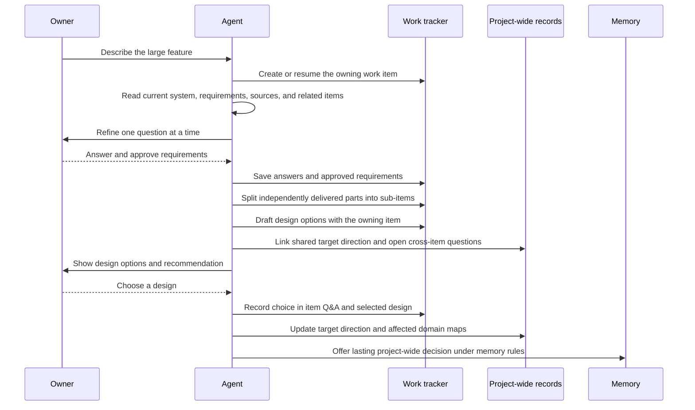

The item design remains the buildable solution. A target architecture page contains only direction shared by several items and states whether the owner accepted it.

## 4. An answer changes after design has started

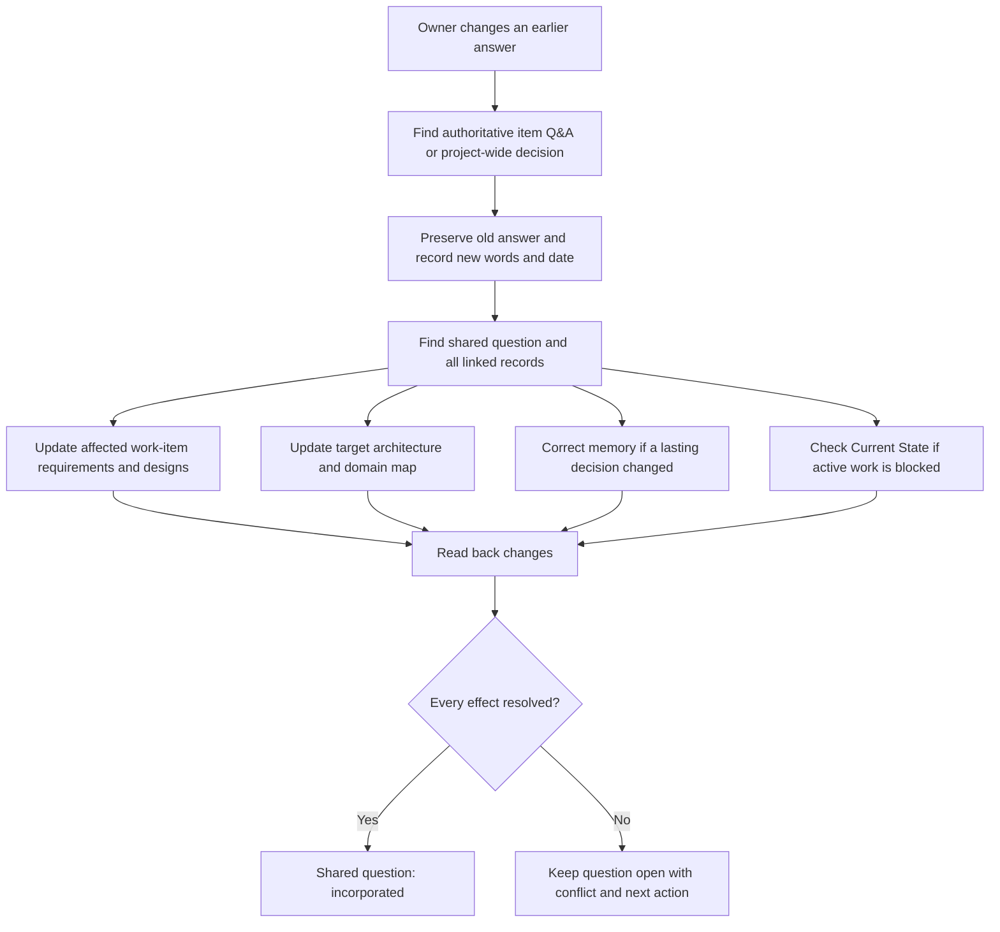

The existing work-item approval rules still apply when an approved requirement or design changes. A project-wide record cannot approve that change on its own.

## 5. A new source contradicts the current direction

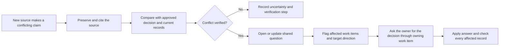

A stakeholder claim is evidence until the owner confirms what the project should do. An agent does not silently replace an approved decision.

## 6. Decision authority changes

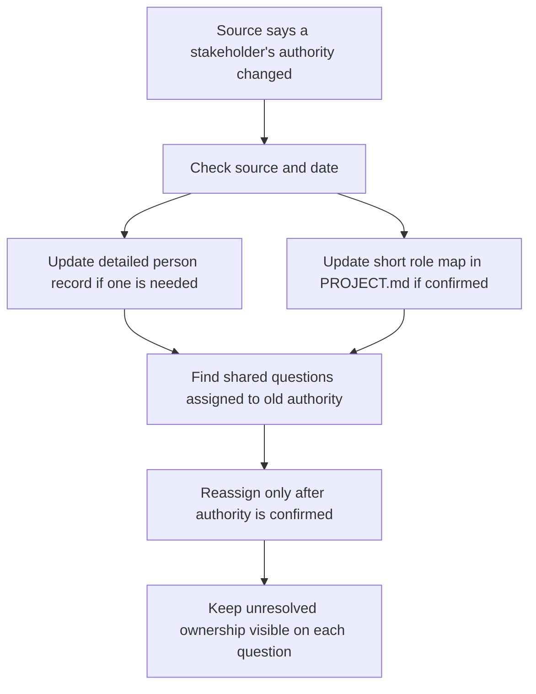

The person record holds project role and decision authority, not a biography or unnecessary personal details. `PROJECT.md` stays the short route to owners.

## 7. A fresh agent resumes the project

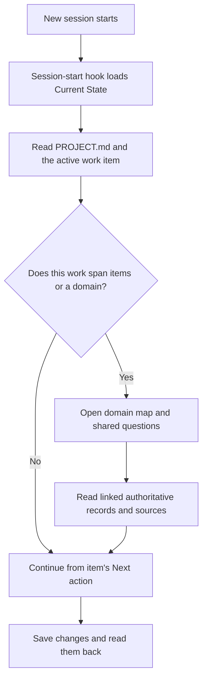

Current State points to a shared question only while it blocks active work. The domain map is a route to records, not a second status list.

## 8. A feature is delivered and reflected into maintained records

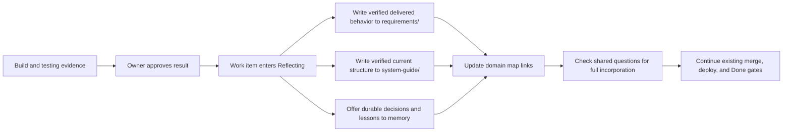

Target architecture does not automatically become current architecture. The system guide changes only after its structure is verified.

## 9. Outside documentation informs a design

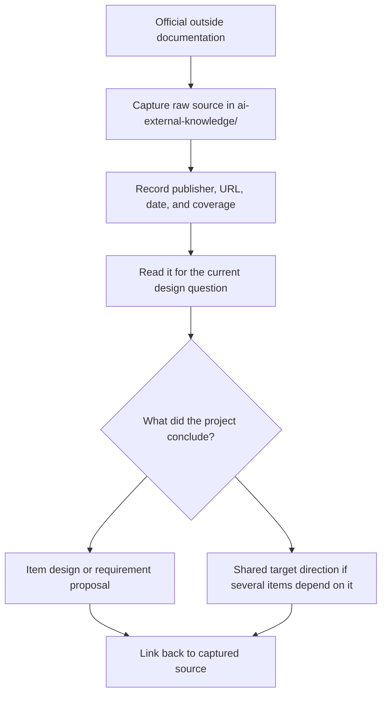

The captured page remains source material. Its wording is not copied into a project-wide record as though it were an accepted project decision.

## 10. Mixed tracker and memory choices

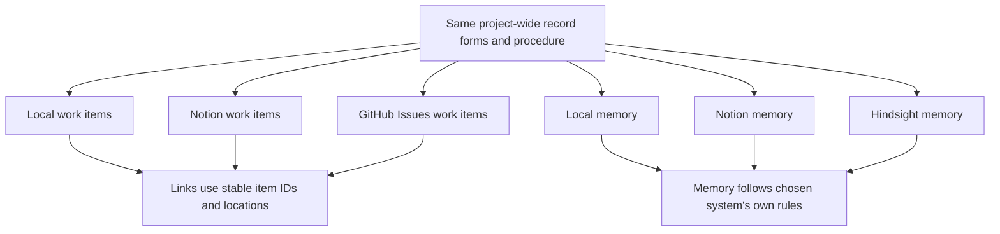

The forms and placement rules do not change with the work tracker or memory choice. Only the steps for reading and writing those existing stores change.

## What these examples must prove in a test

An end-to-end test should show that an agent can find the source, the owning answer, every affected record, and the next action from a fresh session. A changed answer must update or explicitly flag each affected record. A failed save leaves the intake or shared question open. The test must also show that the agent does not copy a transcript into Git, treat a proposed target as current structure, or use memory as a second work tracker.
