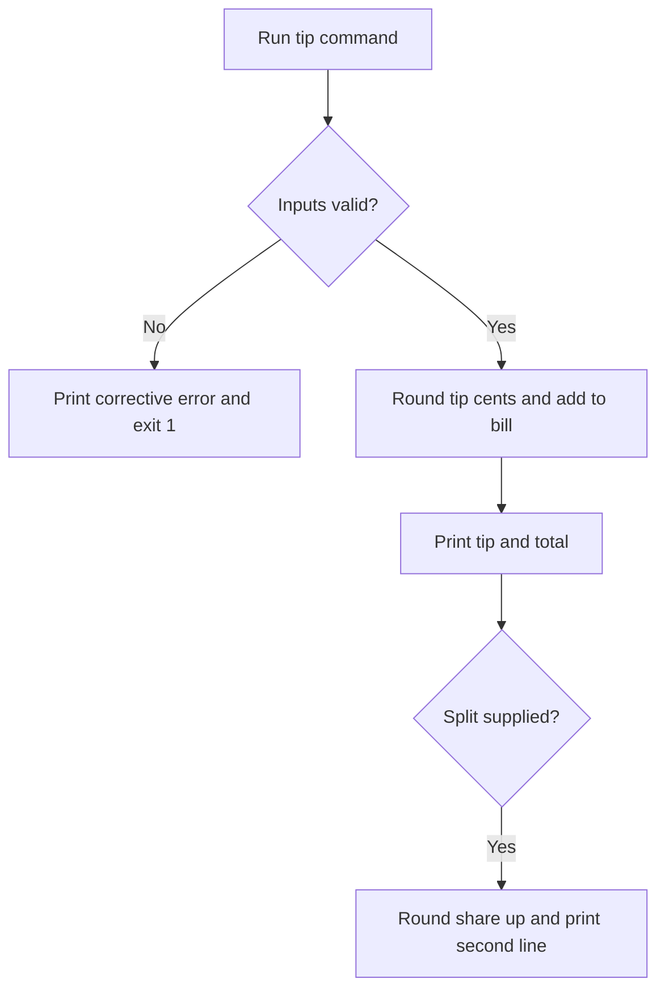

# WI-001: Build the tip command with split option — solution design

**Requirements:** WI-001  
**Design status:** Approved  
**Requirements checked:** WI-001 Active requirements and Acceptance, 2026-09-28  
**Last updated:** 2026-09-28  
**Design approval:** Approved by Mike Rihm on 2026-09-28

## What this design solves

A person runs `node bin/tipcalc.js` with a bill amount and `--percent` to see the tip and total. Adding `--split` shows an amount per person that covers the total when multiplied by the split count. Invalid input gives a correction and exit code 1. This design covers the command and its checks; it does not add installation or publishing.

## Requirements and design readiness

The three requirements are finalized and ready to design. Q-01 through Q-03 are answered. The earlier independent requirements check found no blocking gaps.

| Requirement | Status in work item | Design coverage | Remaining decision or gap |
| --- | --- | --- | --- |
| R-01 — Show tip and total | Finalized | Option A calculation and output | None |
| R-02 — Show a share when splitting | Finalized | Option A split calculation and second line | None |
| R-03 — Explain invalid input | Finalized | Option A parsing and error path | None |

## What exists today

The repository has no `bin/` command or application code. The work item records that no command has been built. No existing calculation needs to be retained.

## Constraints and assumptions

| Type | Constraint or assumption | Source and status | Effect on the design |
| --- | --- | --- | --- |
| Constraint | Run as `node bin/tipcalc.js`; use `--percent` and optional `--split`. | WI-001 Starting request, approved 2026-09-28 | Defines the command interface. |
| Constraint | Use actionable errors and Node built-in `node:test`, without npm test packages. | Project memory, existing preference | Keeps the command dependency free. |
| Assumption | Accept ordinary decimal digits for percentages, including fractional percentages, with no arbitrary precision limit. | Design choice; proposed | Exact decimal parsing keeps half-cent rounding consistent. |
| Assumption | Reject unknown or repeated options with an explanatory error. | Design choice; proposed | Avoids silently ignoring mistyped arguments. |

## Design options

### Option A — One command with exact cent arithmetic

#### Approach

Add `bin/tipcalc.js` as a Node command and `tests/tipcalc.test.js` using `node:test`. Parse numeric input as decimal text and calculate with integer cents and `BigInt`, which holds whole numbers without binary floating point rounding. Keep argument parsing and calculation in the command because this is the only application behavior. Add no runtime package.

#### End-to-end behavior

1. The person runs `node bin/tipcalc.js <bill> --percent <percentage>` and may add `--split <people>`.
2. The command accepts a bill of zero or more with at most two decimal places, a percentage from 0 to 100, and, when present, a split count that is a whole number of 1 or more. If any input is missing or invalid, it writes an error naming the input and valid form to standard error and exits with code 1.
3. It calculates the tip in cents, rounds a half cent up, adds that rounded tip to the bill, and prints `Tip: $x.xx  Total: $y.yy`.
4. With `--split`, it divides total cents by the positive whole split count, rounds each share up to a cent, and prints `Each person pays: $z.zz` on a second line.

#### Requirement coverage

| Requirement | Build or reuse | Why it meets the requirement | How to check it |
| --- | --- | --- | --- |
| R-01 | New `bin/tipcalc.js` decimal parser, cent calculation, and formatter | Rounds the tip before adding it to the bill and prints two decimal places. | Run the $50, $0.05, and $0 examples. |
| R-02 | New optional `--split` path in `bin/tipcalc.js` | Uses total cents and rounds each share upward. | Run the 3-person and uneven split examples. |
| R-03 | New argument checks and error messages in `bin/tipcalc.js` | Rejects bills below zero or with more than two decimal places, percentages outside 0 to 100, split counts below 1 or with a fraction, and missing or malformed input with exit code 1. | Run each invalid input case and inspect standard error and exit code. |

#### Technical shape

- **Components and files:** New `bin/tipcalc.js` owns argument parsing, calculation, and output. New `tests/tipcalc.test.js` runs the command as a child process and checks output and exit codes.
- **Data and state:** No stored data. Accept a nonnegative bill with at most two fractional digits and convert it to integer cents. Accept a percentage from 0 to 100 and represent it as its decimal digits over a power of ten. Accept a positive whole split count. For bill cents `B`, percentage digits `P`, and decimal scale `S`, round `B × P / (100 × 10^S)` to the nearest whole cent, with a half cent rounded up. Compute total cents as bill cents plus rounded tip cents. Compute each share as the ceiling of total cents divided by the split count.
- **Access and security:** The command reads its own arguments and writes output. It opens no files or network connections. Validate numeric text before converting it.
- **Integrations:** The interface is the command line only; valid results go to standard output, errors to standard error.
- **Operations:** Run with Node. Tests use `node --test`. There is no installation step, migration, or service to operate.

#### Tradeoffs and risks

| Tradeoff or risk | Likelihood and effect | Mitigation or owner decision |
| --- | --- | --- |
| `BigInt` is less familiar than `Number`. | A future edit could mix numeric types or change the rounding. | Keep conversions in small functions and test half-cent and split cases. |
| Every share is rounded up. | For an uneven split, the displayed shares can sum to more than the total. | Follow R-02 and test the $10 split among 3 example. |
| Very large input can use substantial memory. | Unlikely for a restaurant bill; no maximum amount was specified. | Validate syntax before conversion; do not introduce an unapproved limit. |

#### Build order

1. Add argument parsing and validation in `bin/tipcalc.js`; confirm invalid input writes a useful error and exits 1.
2. Add exact cent calculations and formatting; confirm the required tip and total examples.
3. Add split calculation and output; confirm even and uneven split examples.
4. Add `node:test` process checks for R-01 through R-03 and run the full set. Include bill 0, percent 0 and 100, split 1, the $0.05 half-cent tip, the uneven $10 split, and each missing or invalid input from R-03.

## Recommendation and owner decision

**Recommendation:** Approve Option A. It meets the three requirements with one command, no runtime dependency, and exact cent rounding.  
**Owner decision:** Mike Rihm approved Option A in chat on 2026-09-28, with `--split` as a child item after the plain tip and total are built and checked.  
**Reason for decision:** The owner wants the plain tip and total built and checked first.

## Selected design

Use Option A in two delivery phases. WI-001 builds and checks the plain tip and total first. A child item then adds and checks `--split` using the same command and calculation.

### End-to-end flow

Parse the bill and `--percent`, validate them, calculate the rounded tip and total, and print the first line. After that result is checked, the child item adds optional `--split` validation, calculates the rounded up share, and prints the second line.

### Components and responsibilities

`bin/tipcalc.js` owns argument parsing, exact cent calculation, and output. `tests/tipcalc.test.js` runs the command and checks output, errors, and exit codes with Node built-in `node:test`. The child item extends these files for `--split`.

### Data, access, and integration details

Parse decimal text into `BigInt` integer units to avoid floating point rounding. Keep all work local to the command; no files, persistent state, external service, or runtime package is required.

### Edge cases and failure behavior

Reject missing, malformed, negative, or overly precise bills and percentages outside 0 to 100 with a corrective error on standard error and exit code 1. Reject unknown or repeated options. The child item adds split count checks for positive whole numbers. Round half cents up for tips; round uneven shares up to a cent.

### Release and ongoing operation

Run with `node bin/tipcalc.js`. Verify with `node --test`. No installation, migration, or deployment is part of the design.

## Diagrams

The command reads arguments, validates them, calculates the tip and total, and prints the optional share. Invalid arguments produce an error and exit code 1.

## Build and verification plan

### Technical sequence

1. WI-001: build argument validation and exact tip and total calculation; add `node:test` checks for R-01 and the bill and percentage cases of R-03. Run the checks and review the plain command before starting the child.
2. Child item: add `--split` parsing, share calculation, and the second output line; add checks for R-02 and the split cases of R-03. Run the full set.

### Acceptance checks

| Requirement | Check |
| --- | --- |
| R-01 | Verify the exact $50 at 20 percent line, the $0.05 at 10 percent half-cent case, and a $0 bill at 0 percent. |
| R-02 | In the child item, verify the $50 split among 3, $10 split among 3 rounded up, $0.05 split among 2, and split count 1. |
| R-03 | Verify missing and invalid bill and percentage inputs in WI-001; verify missing and invalid split counts in the child. Check corrective standard error and exit code 1. |

## Sources and decisions that affect the build

| Claim or decision | Source | Date | Evidence type | Checked how |
| --- | --- | --- | --- | --- |
| Command and printed examples | WI-001 Starting request and R-01 to R-03 | 2026-09-28 | Owner decision | Requirements approval recorded. |
| No command exists yet | Repository file scan and WI-001 Overview | 2026-09-28 | Project evidence | Checked repository files. |
| `node:test` without npm test packages | Project memory `user_coding_preferences` | 2026-09-28 | Project evidence | Read project briefing. |

## Where a builder could misread this design

| Requirement or section | Plausible wrong reading | Intended reading and how the design makes it clear |
| --- | --- | --- |
| R-01 | Round the total or each display value separately. | Round tip cents first, then add bill cents to get total cents. |
| R-01 | Use binary floating point and rely on `toFixed(2)` for half cents. | Parse decimal text and use integer arithmetic for the half-up rule. |
| R-02 | Round a split share to the nearest cent. | Round each share upward so the combined shares cover the total. |
| R-03 | Return an error code without telling the person how to fix input. | Name the invalid input and its valid range or form in standard error. |

## Notes

### Open design questions

The owner requested a child item for `--split`, with the plain tip and total built and checked first. The calculation and command shape remain Option A.

### Design changes during the interview

None.

### Current position and next step

Option A was approved by Mike Rihm on 2026-09-28. Record design approval, create the `--split` child item, and plan the plain command first.
