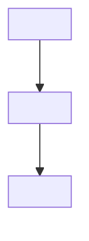

# WI-001: <Work item title> — solution design

<!-- Fill-in guide: replace WI-001 and every angle-bracket prompt with the actual value in that exact heading, field, table cell, or paragraph, and delete this guide. Add rows or options where needed; remove unused example rows, and each section or heading the template says to remove when unused. When the owner answers a question, update the relevant design section and the matching Questions and Answers row in the work item, then update Notes at the bottom and the work item's Current state. -->

**Requirements:** WI-001  
**Requirements checked:** <YYYY-MM-DD, the date this design was last checked against the work item's requirements>  
**Last updated:** <YYYY-MM-DD>

<!-- Keep this file with its work item. The work item's main file, not this file, holds the goal, its Current state (where work stands and the exact next action), the requirements, Questions and Answers (which holds the item's decisions), its Roadmap and Tasks, its Recent History, and whether this design is proposed, approved, or superseded (its `design` field). This file explains how to meet those requirements. During an interview, update settled answers in the relevant design section, keep unresolved discussion in Notes at the bottom, and keep the next action in the work item's Current state. A recommendation or saved draft is not owner approval. -->

## What this design solves

<In a short paragraph, say who uses the result, what they need to accomplish, and what must be true afterward. Link to the work item's goal. State what this design covers and what it leaves to another work item.>

## Requirements and design readiness

<Say whether the work item's requirements are ready to design from. Do not use this design to fill a missing requirement; return gaps to the work item's Questions and Answers for an owner decision.>

| Requirement | Status in work item | Design coverage | Remaining decision or gap |
| --- | --- | --- | --- |
| R-01 — <Requirement short name> | <Approved / Not approved yet / Dropped> | <Option and section that address it, or Pending> | <Question ID or None> |

## What exists today

<For an existing build, describe verified current behavior, relevant files or configuration, and the gap. For a new build, say that nothing exists yet. Distinguish observed facts from assumptions.>

## Constraints and assumptions

| Type | Constraint or assumption | Source and status | Effect on the design |
| --- | --- | --- | --- |
| <Constraint / Assumption> | <Specific statement> | <CON-##, DEC-###, SRC-###, a link, or a person and date; confirmed or open> | <What it limits or changes> |

## Design options

<!-- Include the number of options chosen for this design (the owner's number when he gave one). Keep each option in this file with the same subsections. Remove unused option headings. Describe options as proposals until the owner chooses one. -->

### Option A — <Short name>

#### Approach

<Explain in plain language the approach, why it fits the goal, and what is reused, changed, or new.>

#### End-to-end behavior

1. <Who starts the flow, when, and with what input.>
2. <What the system or team does, including a decision or failure path.>
3. <What the person sees or receives and what happens afterward.>

#### Requirement coverage

| Requirement | Build or reuse | Why it meets the requirement | How to check it |
| --- | --- | --- | --- |
| R-01 | <Exact component, setting, or process; new/changed/reused> | <How required behavior follows> | <Test or observable result> |

#### Technical shape

- **Components and files:** <Names, responsibilities, and what changes.>
- **Data and state:** <Records, fields, ownership, lifecycle, and migration if applicable.>
- **Access and security:** <Who may see or change what, and where checks occur.>
- **Integrations:** <Systems, interfaces, events, and failure handling.>
- **Operations:** <Monitoring, support, backup, rollback, and ongoing ownership where relevant.>

#### Tradeoffs and risks

| Tradeoff or risk | Likelihood and effect | Mitigation or owner decision |
| --- | --- | --- |
| <Specific concern> | <What could happen and its impact> | <Action, fallback, or question> |

#### Build order

1. <First build step and why it comes first.>
2. <Next dependent step and its completion check.>

<!-- If several options are wanted, repeat the Option A subsections as Option B, Option C, and so on. -->

## Option comparison

<!-- Keep this section when there is more than one option; otherwise remove it. Compare the differences that matter to the owner. -->

| Criterion | Option A | Option B | Evidence or uncertainty |
| --- | --- | --- | --- |
| <Requirement coverage, effort, risk, operations, or another agreed criterion> | <Assessment> | <Assessment> | <Source or open question> |

## Recommendation and owner decision

**Recommendation:** <Option and reason, including the main cost or tradeoff. A recommendation is not approval.>  
**Owner decision:** <Pending, or chosen option with who decided, when, and the Q-ID of the work item's Questions and Answers row that records the choice.>  
**Reason for decision:** <Owner's reason if given; do not invent one.>

<!-- With a single option, keep the owner decision and remove the comparison and recommendation text. -->

## Selected design

<Before an option is chosen, write “Pending owner decision.” Afterward, make this the current buildable design. Update it when an interview answer changes the chosen approach; keep the option sections above; mark a replaced option “Superseded by Option <letter>” under its heading.>

### End-to-end flow

1. <Trigger, actor, and input.>
2. <Steps, decisions, error paths, and handoffs in order.>
3. <Result, user feedback, and what happens next.>

### Components and responsibilities

| Component or file | New, changed, or reused | Responsibility | Requirement IDs |
| --- | --- | --- | --- |
| <Exact name or path> | <New / Changed / Reused> | <Specific behavior> | R-01 |

### Data, access, and integration details

<Describe the chosen data model and state changes, access rules, system boundaries, interfaces, and ownership at enough detail for a builder to implement without guessing. State “Not applicable” for a genuinely unused area.>

### Edge cases and failure behavior

| Situation | Expected behavior | How it will be checked |
| --- | --- | --- |
| <Missing data, duplicate, denied access, integration outage, or other relevant case> | <Exact result and recovery> | <Test or observation> |

### Release and ongoing operation

<Describe deployment order, migration or backfill, rollback, monitoring, support handoff, and operating owner where relevant.>

## Diagrams

<Add Mermaid diagrams when they clarify the chosen flow, component relationships, data movement, states, or deployment. Give each diagram a descriptive heading and a one-sentence explanation. Keep diagrams consistent with the written design and update both when the design changes. Remove unused examples; a diagram does not replace the behavior and failure details above.>

### <Diagram name and type>

<What this diagram shows, including any boundary or exception that the drawing omits.>

<If a diagram cannot be rendered, describe its essential sequence or relationships in text here. Add further Mermaid diagrams only where useful.>

## Build and verification plan

### Technical sequence

1. <Build step, dependencies, and artifact.>
2. <Next step and completion evidence.>

### Acceptance checks

| Requirement or acceptance criterion | Verification method | Expected result | Evidence location |
| --- | --- | --- | --- |
| R-01 | <Test, review, or demonstration> | <Observable pass condition> | <Where evidence will be recorded> |

## Sources and decisions that affect the build

| Claim or decision | Source | Date | Evidence type | Checked how |
| --- | --- | --- | --- | --- |
| <Fact or choice that changes the design> | <DEC-###, a rule ID in `system/`, SRC-###, an exact link, or the Q-ID of the owner's answer> | <YYYY-MM-DD> | <Official documentation / Project evidence / Owner decision / Community claim> | <Verification or Pending> |

<Do not treat an unchecked community claim or an assistant proposal as a verified fact or owner decision.>

## Where a builder could misread this design

| Requirement or section | Plausible wrong reading | Intended reading and how the design makes it clear |
| --- | --- | --- |
| R-01 | <Likely mistake> | <Correct interpretation and relevant design detail> |

## Notes

### Open design questions

| Question | Affects | Decision needed from | Status | Next step |
| --- | --- | --- | --- | --- |
| <Question and its Q-ID in the work item's Questions and Answers, where its answer and date are recorded> | <Section or requirement> | <Person or role, or unknown> | Open | <Action> |

### Design changes during the interview

| Date | Answer or decision | Section updated | Source and approval state |
| --- | --- | --- | --- |
| <YYYY-MM-DD> | <What changed> | <Heading> | <Q-ID or link; proposed or approved> |
